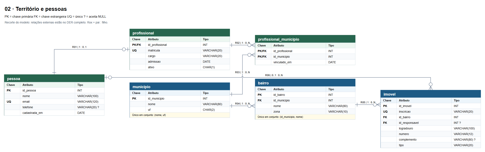
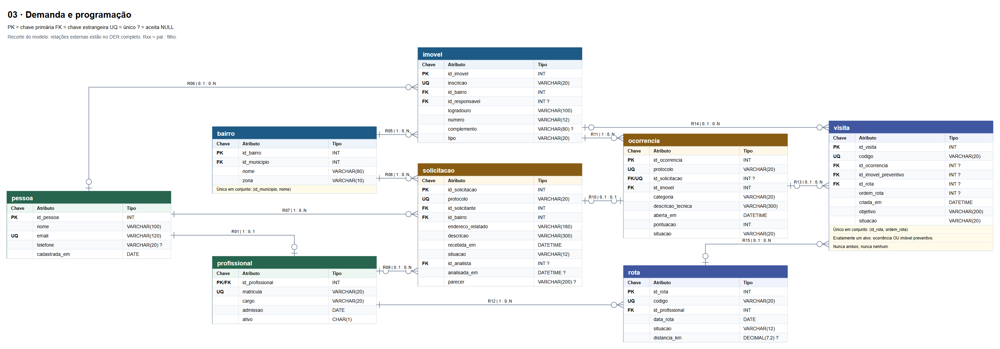
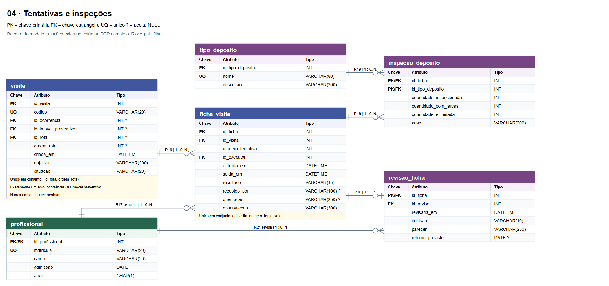

# Guia para montar o DER diretamente no Draw.io

Este guia permite construir o desenho do zero, manualmente. O arquivo pronto é apoio, não uma etapa obrigatória. Use os nomes e campos abaixo para que seu desenho corresponda ao SQL.

## 1. Entender o desenho

**Conceitual:** mostra conceitos e relacionamentos sem exigir tipos MySQL ou FKs físicas. Pode mostrar Profissional N:N Município e Ficha N:N TipoDeposito diretamente.

**Lógico/físico desta entrega:** mostra as 14 tabelas, campos, PKs, FKs, tipos MySQL e participação mínima/máxima. As N:N são resolvidas por profissional_municipio e inspecao_deposito. É esse desenho que será montado e incluído no relatório.

Não desenhe uma N:N direta adicional no físico: ela já está representada pelas duas ligações da associativa. Equipe, Vacina, Animal, Exame e Campanha não existem neste recorte.

## 2. Abrir uma folha

1. Acesse [app.diagrams.net](https://app.diagrams.net/).
2. Se perguntar onde salvar, escolha **Dispositivo / Device**.
3. Escolha **Criar novo diagrama / Create New Diagram**. Se outro arquivo estiver aberto, use **Arquivo → Novo / File → New**.
4. Nomeie **zoonoses_campo_manual.drawio**, escolha **Diagrama em branco / Blank Diagram** e clique Criar.
5. No menu de contexto da aba inferior, renomeie a página para **DER físico completo**.
6. Clique **Mais formas / More Shapes**, no fim do painel esquerdo. Em **Software**, marque **Entity Relation / Relação de entidades** e clique **Aplicar / Apply**.
7. Ative o painel de formatação pela opção de exibição se ele não estiver visível à direita. Use canvas livre: não comprima 14 tabelas em A4.

## 3. Criar entidades com linhas e colunas

8. Faça cada entidade como uma tabela visual: cabeçalho com o nome e três colunas **Chave | Atributo | Tipo**. Use uma célula real para cada valor; não cole todos os atributos em um único retângulo.
9. Para construir manualmente, desenhe um cabeçalho retangular de **480 × 36**. Logo abaixo, faça três células de títulos com larguras **76, 263 e 141**, todas com altura **26**. Os títulos são Chave, Atributo e Tipo.
10. Faça a primeira linha de atributos abaixo dos títulos: três células com as mesmas larguras e altura **27**. Preencha a chave na primeira, o nome do atributo na segunda e o tipo na terceira. Duplique essa linha para cada atributo. Deixe a célula de chave vazia quando não houver PK/FK/UQ.
11. Use Arial **14** nas linhas, **13 em negrito** nos títulos das colunas e **18 em negrito** no cabeçalho. Alinhe à esquerda, centralize verticalmente e deixe margem esquerda de 10. Cabeçalho com fundo escuro e letras brancas; linhas claras alternadas. Não habilite quebra de linha para os nomes e tipos.
12. Selecione todas as células de uma entidade e agrupe com **Ctrl+G** para mover o conjunto. Repita para as 14 entidades. No arquivo pronto, cada entidade já é um contêiner com células filhas; dê duplo clique na célula desejada para editar. Mova a entidade pelo contorno externo, preservando suas linhas internas.

PK é chave primária, FK é chave estrangeira e UQ indica unicidade simples. **?** significa NULL permitido. Sem ?, o campo é obrigatório por NOT NULL ou PRIMARY KEY. Nas associativas, os dois campos PK formam uma única chave composta.

Os tipos são os mesmos do SQL: INT, CHAR, VARCHAR, DATE, DATETIME e DECIMAL. DATETIME mantém data e horário na mesma informação. DECIMAL(7,2) foi preservado para a distância em quilômetros, que pode ter casas decimais. Não altere os tipos apenas no desenho.

## 4. Organizar por módulos

Todas as entidades têm largura **480**. Altura = **62 + 27 × quantidade de atributos**. As colunas começam em X relativo **0, 76 e 339**. As linhas de atributos começam em Y relativo **62**, aumentando 27 a cada linha. Essa estrutura evita concatenar campos e permite alinhar os tipos.

Use o painel Organizar / Arrange para reproduzir as posições abaixo. As quatro páginas foram reorganizadas; estas coordenadas substituem as da versão anterior.

### 01 · DER completo

| Entidade | X | Y | Largura | Altura |
|---|---|---|---|---|
| municipio | 35 | 700 | 480 | 143 |
| pessoa | 35 | 1020 | 480 | 197 |
| profissional | 637 | 733 | 480 | 197 |
| profissional_municipio | 1239 | 405 | 480 | 143 |
| bairro | 637 | 1211 | 480 | 170 |
| imovel | 1239 | 1400 | 480 | 278 |
| solicitacao | 1239 | 979 | 480 | 359 |
| ocorrencia | 1841 | 1141 | 480 | 305 |
| rota | 1841 | 856 | 480 | 224 |
| visita | 2443 | 998 | 480 | 305 |
| ficha_visita | 3045 | 340 | 480 | 332 |
| tipo_deposito | 3045 | 135 | 480 | 143 |
| inspecao_deposito | 3647 | 167 | 480 | 224 |
| revisao_ficha | 3647 | 523 | 480 | 224 |

### 02 · Território e pessoas

| Entidade | X | Y | Largura | Altura |
|---|---|---|---|---|
| municipio | 637 | 393 | 480 | 143 |
| pessoa | 35 | 342 | 480 | 197 |
| profissional | 637 | 135 | 480 | 197 |
| profissional_municipio | 1239 | 165 | 480 | 143 |
| bairro | 1239 | 376 | 480 | 170 |
| imovel | 1841 | 411 | 480 | 278 |

### 03 · Demanda e programação

| Entidade | X | Y | Largura | Altura |
|---|---|---|---|---|
| pessoa | 35 | 553 | 480 | 197 |
| profissional | 637 | 744 | 480 | 197 |
| bairro | 637 | 376 | 480 | 170 |
| imovel | 1239 | 135 | 480 | 278 |
| solicitacao | 1239 | 475 | 480 | 359 |
| ocorrencia | 1841 | 388 | 480 | 305 |
| rota | 1841 | 774 | 480 | 224 |
| visita | 2443 | 388 | 480 | 305 |

### 04 · Tentativas e inspeções

| Entidade | X | Y | Largura | Altura |
|---|---|---|---|---|
| profissional | 35 | 665 | 480 | 197 |
| visita | 35 | 299 | 480 | 305 |
| ficha_visita | 637 | 340 | 480 | 332 |
| tipo_deposito | 637 | 135 | 480 | 143 |
| inspecao_deposito | 1239 | 167 | 480 | 224 |
| revisao_ficha | 1239 | 523 | 480 | 224 |

## 5. Conectar e escrever cardinalidades

13. Comece por **pessoa → profissional**. Passe o mouse na borda do pai, arraste um conector até a filha e solte quando a borda de destino estiver destacada.
14. Use conexões com segmentos horizontais e verticais, sem diagonais entre módulos. Em **Estilo / Style**, escolha terminações ER em pé de galinha. No revisado, os caminhos têm pontos de dobra explícitos; ao mover uma entidade, ajuste esses pontos para manter os ângulos retos.
15. Considere **origem = pai** e **destino = filha**. “Junto ao pai” informa quantos pais cada filho pode ter; “junto à filha”, quantos filhos cada pai pode ter.
16. Para números, dê duplo clique perto de cada ponta e escreva a cardinalidade. No meio, escreva R01, R02 etc. Em R01, perto de pessoa fica **1** e perto de profissional fica **0..1**: nem toda pessoa é profissional.
17. Em pé de galinha: **1** = duas barras; **0..1** = círculo e barra; **0..N** = círculo e pé de galinha. Se houver dúvida, acrescente os números.
18. Repita as **21 ligações** da seção 7. Não conecte campos apenas por terem nomes parecidos.
19. Afaste as linhas das caixas e dos textos. Cruzamento sem nó não cria relacionamento; não coloque um ponto no cruzamento.
20. Ao lado de visita, escreva: **“Exatamente um alvo: id_ocorrencia OU id_imovel_preventivo. Nunca ambos; nunca nenhum.”**

No revisado, cada rótulo usa **Rxx | pai : filha**, com símbolos ER nas pontas. **R16 | 1 : 0..N** significa uma visita por ficha e zero ou várias fichas por visita. As ligações partem do pai para a filha no XML; os símbolos indicam cardinalidade, não direção de consulta. Os rótulos pertencem às conexões, não são caixas de texto soltas.

## 6. Texto exato de cada caixa

Use cada bloco como referência para preencher as três colunas: a indicação PK/FK/UQ vai em Chave; o nome antes dos dois-pontos vai em Atributo; o tipo e eventual ? vão em Tipo. Cada campo ocupa uma linha própria. Não cole o bloco inteiro em uma única célula. CHECKs e DEFAULTs completos estão no dicionário.

### municipio

```text
municipio

PK id_municipio : INT
nome : VARCHAR(80)
uf : CHAR(2)
```

### pessoa

```text
pessoa

PK id_pessoa : INT
nome : VARCHAR(100)
UQ email : VARCHAR(120)
telefone : VARCHAR(20) ?
cadastrada_em : DATE
```

### profissional

```text
profissional

PK/FK id_profissional : INT
UQ matricula : VARCHAR(20)
cargo : VARCHAR(20)
admissao : DATE
ativo : CHAR(1)
```

### profissional_municipio

```text
profissional_municipio

PK/FK id_profissional : INT
PK/FK id_municipio : INT
vinculado_em : DATE
```

### bairro

```text
bairro

PK id_bairro : INT
FK id_municipio : INT
nome : VARCHAR(80)
zona : VARCHAR(10)
```

### imovel

```text
imovel

PK id_imovel : INT
UQ inscricao : VARCHAR(20)
FK id_bairro : INT
FK id_responsavel : INT ?
logradouro : VARCHAR(100)
numero : VARCHAR(12)
complemento : VARCHAR(80) ?
tipo : VARCHAR(20)
```

### solicitacao

```text
solicitacao

PK id_solicitacao : INT
UQ protocolo : VARCHAR(20)
FK id_solicitante : INT
FK id_bairro : INT
endereco_relatado : VARCHAR(180)
descricao : VARCHAR(300)
recebida_em : DATETIME
situacao : VARCHAR(12)
FK id_analista : INT ?
analisada_em : DATETIME ?
parecer : VARCHAR(200) ?
```

### ocorrencia

```text
ocorrencia

PK id_ocorrencia : INT
UQ protocolo : VARCHAR(20)
FK/UQ id_solicitacao : INT ?
FK id_imovel : INT
categoria : VARCHAR(20)
descricao_tecnica : VARCHAR(300)
aberta_em : DATETIME
pontuacao : INT
situacao : VARCHAR(20)
```

### rota

```text
rota

PK id_rota : INT
UQ codigo : VARCHAR(20)
FK id_profissional : INT
data_rota : DATE
situacao : VARCHAR(12)
distancia_km : DECIMAL(7,2) ?
```

### visita

```text
visita

PK id_visita : INT
UQ codigo : VARCHAR(20)
FK id_ocorrencia : INT ?
FK id_imovel_preventivo : INT ?
FK id_rota : INT ?
ordem_rota : INT ?
criada_em : DATETIME
objetivo : VARCHAR(200)
situacao : VARCHAR(20)
```

### ficha_visita

```text
ficha_visita

PK id_ficha : INT
FK id_visita : INT
numero_tentativa : INT
FK id_executor : INT
entrada_em : DATETIME
saida_em : DATETIME
resultado : VARCHAR(15)
recebido_por : VARCHAR(100) ?
orientacao : VARCHAR(250) ?
observacoes : VARCHAR(300)
```

### tipo_deposito

```text
tipo_deposito

PK id_tipo_deposito : INT
UQ nome : VARCHAR(80)
descricao : VARCHAR(200)
```

### inspecao_deposito

```text
inspecao_deposito

PK/FK id_ficha : INT
PK/FK id_tipo_deposito : INT
quantidade_inspecionada : INT
quantidade_com_larvas : INT
quantidade_eliminada : INT
acao : VARCHAR(200)
```

### revisao_ficha

```text
revisao_ficha

PK/FK id_ficha : INT
FK id_revisor : INT
revisada_em : DATETIME
decisao : VARCHAR(10)
parecer : VARCHAR(250)
retorno_previsto : DATE ?
```

### Notas de restrições compostas

- municipio: UNIQUE (nome,uf).
- bairro: UNIQUE (id_municipio,nome).
- profissional_municipio: PK (id_profissional,id_municipio).
- ocorrencia: id_solicitacao é UNIQUE quando preenchido e permite NULL.
- visita: UNIQUE (id_rota,ordem_rota); rota e ordem devem estar juntas; alvo exclusivo.
- ficha_visita: UNIQUE (id_visita,numero_tentativa).
- inspecao_deposito: PK (id_ficha,id_tipo_deposito); positivos/eliminados não ultrapassam inspecionados.
- revisao_ficha: PK id_ficha também é FK; no máximo uma revisão por ficha.

As 21 FKs usam ON UPDATE RESTRICT e ON DELETE RESTRICT. Profissional usa a chave de Pessoa; não invente um ID automático independente para essa extensão.

## 7. Lista completa das ligações

**Junto ao pai** = quantos pais cada filho pode ter. **Junto à filha** = quantos filhos cada pai pode ter. A quantidade de dados inseridos não altera a cardinalidade.

| Ligação | Pai / origem | Filha / destino | Junto ao pai | Junto à filha |
|---|---|---|---|---|
| R01 | pessoa.id_pessoa | profissional.id_profissional | 1 | 0..1 |
| R02 | profissional.id_profissional | profissional_municipio.id_profissional | 1 | 0..N |
| R03 | municipio.id_municipio | profissional_municipio.id_municipio | 1 | 0..N |
| R04 | municipio.id_municipio | bairro.id_municipio | 1 | 0..N |
| R05 | bairro.id_bairro | imovel.id_bairro | 1 | 0..N |
| R06 | pessoa.id_pessoa | imovel.id_responsavel | 0..1 | 0..N |
| R07 | pessoa.id_pessoa | solicitacao.id_solicitante | 1 | 0..N |
| R08 | bairro.id_bairro | solicitacao.id_bairro | 1 | 0..N |
| R09 | profissional.id_profissional | solicitacao.id_analista | 0..1 | 0..N |
| R10 | solicitacao.id_solicitacao | ocorrencia.id_solicitacao | 0..1 | 0..1 |
| R11 | imovel.id_imovel | ocorrencia.id_imovel | 1 | 0..N |
| R12 | profissional.id_profissional | rota.id_profissional | 1 | 0..N |
| R13 | ocorrencia.id_ocorrencia | visita.id_ocorrencia | 0..1 | 0..N |
| R14 | imovel.id_imovel | visita.id_imovel_preventivo | 0..1 | 0..N |
| R15 | rota.id_rota | visita.id_rota | 0..1 | 0..N |
| R16 | visita.id_visita | ficha_visita.id_visita | 1 | 0..N |
| R17 | profissional.id_profissional | ficha_visita.id_executor | 1 | 0..N |
| R18 | ficha_visita.id_ficha | inspecao_deposito.id_ficha | 1 | 0..N |
| R19 | tipo_deposito.id_tipo_deposito | inspecao_deposito.id_tipo_deposito | 1 | 0..N |
| R20 | ficha_visita.id_ficha | revisao_ficha.id_ficha | 1 | 0..1 |
| R21 | profissional.id_profissional | revisao_ficha.id_revisor | 1 | 0..N |

R10 tem 0..1 nas duas pontas: solicitação pode não gerar ocorrência e ocorrência pode ser direta. R13/R14 são opcionais separadamente, mas o CHECK exige exatamente um alvo. O mínimo de filhos nas relações 1:N é zero: cadastrar pai não obriga cadastrar filho.

## 8. Páginas de detalhe

21. Use **+** na barra inferior para criar três páginas. São vistas do mesmo modelo:

- **Território e pessoas:** municipio, pessoa, profissional, profissional_municipio, bairro, imovel. Copie R01–R06.
- **Demanda e programação:** pessoa, profissional, bairro, imovel, solicitacao, ocorrencia, rota, visita. Copie R01 e R05–R15.
- **Tentativas, inspeções e revisão:** profissional, visita, ficha_visita, tipo_deposito, inspecao_deposito, revisao_ficha. Copie R16–R21.

22. Copie as caixas da página principal para não redigitar campos. Se os conectores não vierem juntos, refaça somente os indicados. Páginas parciais não exibem todas as FKs para entidades externas: o DER completo é a referência integral.
23. Use os detalhes na apresentação para manter o texto legível.

## 9. Conferir e salvar

24. Conte 14 caixas e 21 conectores no desenho completo. Compare nomes e tipos com DICIONARIO.md e CREATE TABLE.
25. Confira chaves compostas, campos opcionais, 1:0..1 e nota de exclusividade.
26. Examine a 100% de zoom, por módulo. Amplie caixas cortadas e afaste rótulos dos cruzamentos.
27. Use **Arquivo → Salvar como / File → Save As** no formato **.drawio**, preservando objetos editáveis.

## 10. Exportar imagem para o relatório

28. Na página completa, use **Arquivo → Exportar como → PNG / File → Export as → PNG**.
29. Escolha fundo branco, sem grade nem seleção apenas, e margem pequena. Aumente o zoom de exportação; use pelo menos cerca de 4000 pixels de largura para este desenho.
30. Pode ativar “incluir cópia do diagrama”, se disponível. Mantenha também o .drawio separado. Nomeie **der_completo.png**.
31. Coloque a imagem em **diagramas/**. O relatório já contém:

```markdown
[DER editável completo](diagramas/DER.drawio)






```

32. Exporte os detalhes se quiser usá-los na apresentação. Sempre atualize SQL, dicionário, guia e imagens juntos ao mudar o modelo.

## 11. Abrir o arquivo pronto

Use **Arquivo → Abrir de → Dispositivo / File → Open From → Device** e selecione **diagramas/DER.drawio**. Há quatro páginas. As caixas e linhas são objetos editáveis, não imagem colada. Salve o exercício manual com outro nome para comparar.

O arquivo zoonoses_campo.drawio também foi atualizado com o mesmo conteúdo. As quatro páginas foram abertas no Draw.io real, no Chrome, com conferência a 100%. Os PNG/SVG foram obtidos do SVG efetivamente renderizado pelo editor. As capturas de revisão não são versionadas. Para distinguir do arquivo antigo já aberto, use Arquivo → Abrir de → Dispositivo e escolha zoonoses_campo_revisado.drawio; não apenas atualize a aba antiga.

## Referências do editor

- [Biblioteca ER e cardinalidades](https://www.drawio.com/docs/tutorials/crows-foot-notation/).
- [Formatos de exportação](https://www.drawio.com/docs/manual/export/export-diagram/).

Menus podem estar em português ou inglês. Campos, organização e ligações são específicos deste trabalho.

## Complemento de 06/11/2026 — quatro ajustes do DER

O editável revisado e as imagens PNG/SVG contêm notas de unicidade composta junto às respectivas tabelas: municipio(nome, uf), bairro(id_municipio, nome), visita(id_rota, ordem_rota) e ficha_visita(id_visita, numero_tentativa). Essas notas representam UNIQUE composto, sem tornar cada coluna individualmente única.

Junto a visita consta: “Exatamente um alvo: ocorrência OU imóvel preventivo. Nunca ambos; nunca nenhum.” As páginas de detalhe identificam-se como recortes e remetem as relações externas ao DER completo. R17 usa o verbo “executa”; R21 usa “revisa”. Permanecem quatro páginas, 14 tabelas e 21 relações na página completa, sem alteração no SQL ou nos tipos.

As notas acrescentam 25 pixels por linha à altura das caixas. Para reproduzir as posições e alturas finais, use o editável revisado como referência; as coordenadas anteriores deste documento descrevem a base anterior às notas.

O XML e as imagens finais foram conferidos nesta conclusão. A conferência visual foi registrada durante a preparação; não houve nova sessão interativa do editor nesta etapa. As notas e rótulos estão presentes nos PNG/SVG atuais, inclusive no detalhe de tentativas inspecionado visualmente.
